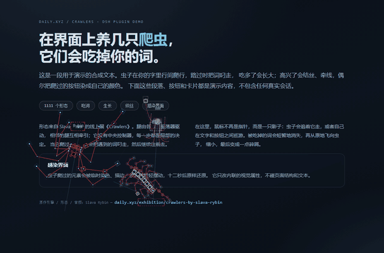

# dsh-crawler

在 [DeepSeek Harness](https://github.com/deepseek-ai) 界面上爬行的小虫子：**1111 个形态**，
吃掉你界面上的词、慢慢长大、结丝、生灭。纯视觉特效，不写入你的内容。



> 动图来自一个**合成的演示页**（自写文案 + 纯色背景），不含任何真实会话、壁纸或用户数据。
> 演示页源码在 [demo/index.html](demo/index.html)，用 `file://` 打开即可复现（加载 `../lib/client.js`）。

## 原作 / Credits

**引擎、1111 个形态与音色都来自艺术家 [Slava Rybin](https://daily.xyz) 的线上展
《Crawlers》**（[daily.xyz/exhibition/crawlers-by-slava-rybin](https://daily.xyz/exhibition/crawlers-by-slava-rybin)）。
虫子的步态、腿部 IK、转向、身体动力学、每种形态自己的音色，都是原作引擎原样跑出来的。

本仓库是 **DSH（DeepSeek Harness）的集成插件**，不是作者的官方作品，也与作者无关。
内置素材的版权归原作者所有，随本仓库仅供个人、实验、非商业使用（见文末[许可](#许可)）。

---

## 特性

| | |
|---|---|
| **1111 个形态** | bug / spider / centipede，腿由各自的振荡器驱动、相邻腿互相牵引 |
| **吃词** | 中文取两字窗口、英文取整词；一颗碎屑飞向虫子 |
| **生长** | 吃得越多越大，上限是原作默认尺寸（`settings.scale = 90`）；**原地平滑变大**，不重置朝向 |
| **生灭** | 每只虫有独立的 3–7 分钟随机寿命，错开死亡与出生 |
| **两种行为** | `全自主探索`（自己在文字/按钮间巡游）/ `跟随鼠标` |
| **躲鼠标** | 光标靠近时主动走开，不挡阅读和点击 |
| **词链 / 框字 / 丝线** | 从虫子身上牵线到附近的词；标本框点缀；走过的路留丝 |
| **吃字消失** | 被吃掉的词在页面上渐隐 0.7 秒（CSS Highlight，不改 DOM/文本） |
| **感染界面** | 爬过的元素染色/描边/滤镜/摆动，12 秒后原样还原（只写内联视觉属性） |
| **音色** | 每只虫子用它自己形态的原作音频 |
| **关闭即停** | 关掉「显示爬虫」会 dispose 整个 overlay：引擎循环、定时器、画布全部释放 |

## 安装

需要能运行 DSH 插件的环境（桌面版或 Web 版）。

**方式一：tgz（推荐）**

从 [Releases](https://github.com/xiangyi-wang/dsh-crawler/releases) 下载
`dsh-external-dsh-crawler-*.tgz`，在 DSH 的插件管理器里安装本地包，然后重启一次。
启动后 `设置 → 爬虫` 里能看到面板，右下角出现小坞。

**方式二：从源码安装（开发用）**

```bash
git clone https://github.com/xiangyi-wang/dsh-crawler.git
cd dsh-crawler
npm pack                      # 构建 client bundle 并打包
# 用 DSH 插件管理器安装生成的 tgz
```

或者把仓库目录链接进 profile 的 `node_modules`，并在 profile `package.json` 的
`dsh.profile.bundles` 里加入 `@dsh-external/dsh-crawler`，重启 DSH。

> 仓库里已经带了构建好的 `lib/`，直接安装不需要 Node 构建环境。

## 设置

`设置 → 爬虫` 与右下角小坞双向同步（任一边改动另一边 0.8 秒内跟上）。

| 设置 | 默认 | 说明 |
|---|---|---|
| 显示爬虫 | 开 | 全局开关；关掉后 overlay 整个 dispose |
| 数量 | 3 | 1–5 只，虫口会在目标值附近漂移 |
| 行为模式 | 全自主探索 | 或「跟随鼠标」 |
| 躲鼠标 | 开 | 光标靠近时走开（仅自主模式） |
| 错开生长 | 开 | 开局随机相位 + 个体生长速度抖动 |
| 体型 | 中 | 只影响**之后出生**个体的起始大小；上限始终是原作尺寸 |
| 速度 | 1.0× | 0.5–2.0× |
| 吃掉文字里的词 | 开 | 只做视觉，不存词库 |
| 词链 | 开 | 从虫子牵线到附近的词 |
| 吃字消失 | 开 | CSS Highlight，0.7 秒后恢复 |
| 感染界面 | 开 | 只改内联视觉属性，12 秒还原 |
| 吃字特效 | 开 | 词从原位飞向虫子 |
| 词条生成 | **关** | 会往 localStorage 写词库/伪维基条目，需要时再开 |
| 随机繁殖 / 死亡 | 开 | 独立寿命，错开生死 |
| 织丝 | 开 | 沿路留丝，约 9 秒淡出 |
| 声音 | **关** | 每只虫子自带音色（自动播放的音频，默认不打开） |

设置保存在 `localStorage["dsh-crawler.v2"]`，换浏览器/清缓存会回到默认值。

## 它是怎么工作的

原作引擎本身是**指针驱动**的：有指针就追，没有指针就原地不动（这点做过对照实验）。
所以插件并没有“发明”一套寻路，而是给引擎喂一只**影子指针**：

- **跟随鼠标**：影子指针追你的鼠标（带一点偏移和平滑），最接近原作的交互
- **全自主探索**：影子指针在 DOM 锚点（文字行、按钮、卡片）之间巡游，会避开你的光标、
  避免几只虫抢同一个位置，并随机停留

原作的「扫描页面文字、吃掉并改写段落」被**关闭**了（那会真的修改宿主 DOM）。
你现在看到的吃词、飞字、换色、感染，都是客户端在**不碰页面结构和文本**的前提下做的视觉层。

### 对引擎的补丁（都不改步态/转向）

1. 暴露 `window.__crawler_api`，让客户端能 `set_active` / 静音 / 读位置
2. 去掉原作页面底纹的方格网
3. 渲染倍率跟随 `devicePixelRatio`（上限 2×），高缩放屏不发虚
4. 视口 = 画布 CSS 尺寸（每只虫一张 560×500 的小画布）
5. 帧率封顶 30fps
6. 画布槽位：多实例各自取自己的画布（原引擎按固定 id 查找）
7. 相机钩子：每帧把画布对准虫子（虫子永远在画布中央）
8. 去掉“按视口压缩 scale”的上限，并允许运行时改 `settings.scale`（生长用）

## 性能

- 每只虫一张 **560×500** 的跟随画布，外加一张全屏特效画布：
  1600×1000 窗口下 4 张画布约 **8.7MB**（1× 屏）/ **14MB**（1.25× 屏）显存
- 引擎帧率封顶 **30fps**；特效画布空闲时整帧跳过
- 关闭「显示爬虫」后所有画布、定时器、监听器都被释放
- 只在浏览器端运行，host 不注册工具、不发请求

## 开发

```bash
node scripts/build-client.cjs
```

- `assets/engine.src.js` 原作引擎（构建时打上面的补丁）
- `assets/seeds.json` 1111 个形态参数
- `assets/audio.json` / `assets/audio-map.json` 音色池 / 每个形态的原作音色
- `src/client/index.js` 手写逻辑（构建时内联进 `lib/client.js`）
- `lib/index.js` host 半边：插件身份 + 开发期热更新路由
- `lib/client.js` 构建产物（ModuleLoader 模块）

开发期热更新：host 在存在 `lib/client.live.js` 时提供 `/dev/rev` 与 `/dev/live.js`，
页面每 2 秒轮询，构建后自动热替换 overlay（正式包不包含这两个文件，路由会自动关闭）。

调试：URL 加 `#crawler-debug` 会得到左上角 HUD 和 `window.__dshCrawler`
（`pets` / `setScale` / `liveScale` / `eat`）。

## 已知限制

- 只在 Chromium 内核（DSH 桌面版 / Web）上验证；「吃字消失」依赖 CSS Custom Highlight API，
  不支持的浏览器会静默跳过该效果
- 感染界面会临时修改页面元素的**内联样式**（12 秒还原）；如果介意可以关掉
- 词条生成会写 localStorage，默认关闭
- 声音默认关闭（浏览器对自动播放有限制）
- 原作素材的再分发权限不在本仓库的许可范围内，见下

## 许可

- **代码**：BSD 3-Clause（见 [LICENSE](LICENSE)）
- **内置素材**（引擎、1111 个形态、音频）：© **Slava Rybin**，来自
  [《Crawlers》](https://daily.xyz/exhibition/crawlers-by-slava-rybin)。
  随本仓库仅供**个人、实验、非商业**使用；**不随本仓库的 BSD 许可再授权**。
  如需商业使用或再分发，请先联系原作者。若你是权利人并希望移除相关内容，请开 issue。
  详细声明见 [NOTICE](NOTICE)。
- 本项目与 DeepSeek、Daily.xyz 及原作者均无隶属关系。

## 版本记录

- **0.1.8** 审计修复：数量设置一次补齐、正式包不再空转热更新、定时器/监听器泄漏、
  吃词样式缓存、清理脚手架、build.sh 改为真正的构建入口
- **0.1.7** 生长改为原地缩放同一引擎实例（不再“方向回正”）；热更新退避可恢复；界面显示版本
- **0.1.6** 打包默认开启所有视觉特效；旧存档一次性迁移
- **0.1.5** 生长换体不再位移；独立寿命，生死不再同步
- **0.1.4** 虫子画布跟随 `devicePixelRatio`（修发虚）；相机与画布同帧（修高频抖动）
- **0.1.3** 每只虫改成 560×500 跟随小画布（显存 23MB → 8.7MB）；能长到原作大小
- **0.1.2** 修复「三只虫画到同一张画布」；30fps 上限；去掉网格绘制
- **0.1.1** 词条生成选项、个人音频映射、打包产物
